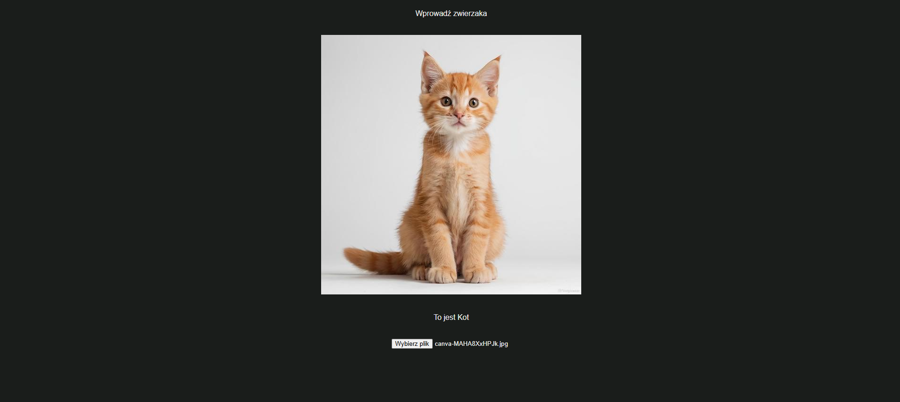
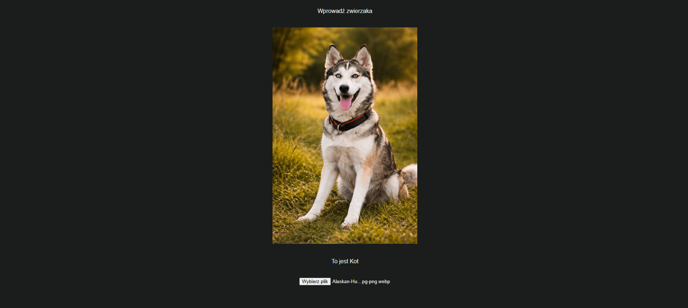

# Cat vs Dog

Aplikacja webowa, która rozpoznaje, czy na zdjęciu jest **kot** czy **pies**. Użytkownik wybiera zdjęcie w przeglądarce, a backend klasyfikuje je wytrenowaną siecią konwolucyjną (TensorFlow/Keras) i zwraca wynik.

## Demo

| Kot | Pies |
|-----|------|
|  |  |

## Struktura projektu

```
catvsdog/
├── backend/                    # API w FastAPI + model
│   ├── main.py                 # endpointy i logika predykcji
│   └── catvsdogs_model.keras   # wytrenowany model Keras
└── dogvscat/                   # frontend w React + Vite
    ├── src/
    │   ├── App.jsx             # wybór zdjęcia, podgląd, wysyłka do API
    │   ├── App.css
    │   └── index.css
    └── package.json
```

## Wymagania

- Python 3.12
- Node.js (z npm)

## Uruchomienie

### 1. Backend

```bash
cd backend
python -m venv .venv
.venv\Scripts\activate          # Windows
# source .venv/bin/activate     # Linux / macOS
pip install fastapi[standard] tensorflow-cpu keras numpy pillow python-multipart
fastapi dev main.py
```

API startuje pod adresem `http://127.0.0.1:8000`. Interaktywna dokumentacja (Swagger) jest dostępna pod `http://127.0.0.1:8000/docs`.

### 2. Frontend

W osobnym terminalu:

```bash
cd dogvscat
npm install
npm run dev
```

Aplikacja otworzy się pod adresem `http://localhost:5173`.

## Jak to działa

1. Użytkownik wybiera zdjęcie (`<input type="file">`). Frontend pokazuje jego podgląd i wysyła plik do API jako `multipart/form-data`.
2. Backend wczytuje obraz i skaluje go do rozmiaru **180×180** (RGB).
3. Model zwraca dwa logity, po jednym dla każdej klasy. Backend przelicza je funkcją `softmax` na prawdopodobieństwa i wybiera klasę o najwyższym prawdopodobieństwie.
4. Frontend wyświetla wynik: „To jest Kot” albo „To jest Pies”.

## API

### `GET /`

Prosty test, czy serwer działa.

```json
{ "Hello": "World" }
```

### `POST /animal`

Klasyfikuje przesłane zdjęcie.

**Żądanie:** `multipart/form-data` z polem `file` (plik obrazu).

```bash
curl -F "file=@kot.jpg" http://127.0.0.1:8000/animal
```

**Odpowiedź:**

```json
{
  "filename": "kot.jpg",
  "class": "Kot",
  "score": 0.994
}
```

| Pole       | Opis                                                 |
|------------|------------------------------------------------------|
| `filename` | nazwa przesłanego pliku                              |
| `class`    | przewidziana klasa: `"Kot"` lub `"Pies"`             |
| `score`    | pewność modelu dla wybranej klasy (od 0.5 do 1.0)    |

## Model

Sekwencyjna sieć CNN zapisana w `backend/catvsdogs_model.keras`:

| Warstwa                    | Wyjście            |
|----------------------------|--------------------|
| Rescaling (1/255)          | 180 × 180 × 3      |
| Conv2D 16 + MaxPooling2D   | 90 × 90 × 16       |
| Conv2D 32 + MaxPooling2D   | 45 × 45 × 32       |
| Conv2D 64 + MaxPooling2D   | 22 × 22 × 64       |
| Flatten                    | 30 976             |
| Dense 128                  | 128                |
| Dense 2 (logity)           | 2                  |

- Normalizacja pikseli jest wbudowana w model (warstwa `Rescaling`), więc backend przekazuje surowe wartości 0–255.
- Model trenowano z funkcją straty `SparseCategoricalCrossentropy(from_logits=True)`, więc ostatnia warstwa nie ma aktywacji. `softmax` nakłada backend.
- Kolejność klas: `0 = Kot`, `1 = Pies` (alfabetyczna kolejność folderów z `image_dataset_from_directory`). Jeśli wyniki są odwrócone, zmień kolejność listy `class_names` w `backend/main.py`.

## Konfiguracja

- **CORS:** lista dozwolonych adresów jest w `origins` w `backend/main.py`. Domyślnie zawiera `http://localhost:5173` (serwer deweloperski Vite).
- **Adres API we frontendzie:** zapisany na sztywno w `dogvscat/src/App.jsx` jako `http://127.0.0.1:8000/animal`.

